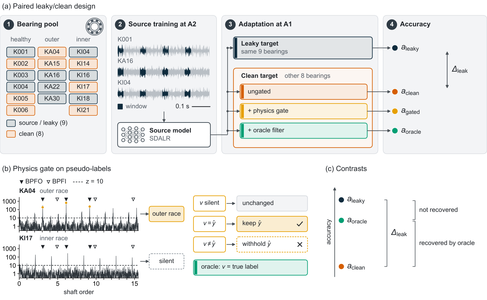

# Bearing-disjoint evaluation of source-free bearing fault diagnosis

[](https://doi.org/10.5281/zenodo.23105809)
[](LICENSE)
[](requirements.txt)

Code, pre-specified protocol, run ledger and retained results for

> **Bearing-disjoint evaluation of source-free bearing fault diagnosis: the unseen-bearing loss, its presence before adaptation and envelope-gated pseudo-labels**<br>
> Mohammad Rafiur Rahman, Chittagong University of Engineering & Technology (CUET), 2026.

Source-free domain adaptation (SFDA) benchmarks for rolling-bearing diagnosis can place the same physical bearings in the
source and the target. On the Paderborn rig, one SDALR source model is adapted to the same bearings and, separately, to
unseen bearings at the same target condition. The difference measures what bearing overlap contributes to the reported
accuracy. Four physics gates on the pseudo-labels are evaluated against an oracle filter.



## Main results

Paderborn, ten pre-specified bearing-disjoint splits (HUST: six splits). Medians over splits.

| Quantity | Median | Splits | Result file |
|---|---|---|---|
| Accuracy loss on unseen bearings, SDALR after adaptation | 36.2 pp | 10 of 10 positive | `results/c109/c109_intervals.json` |
| The same loss for the source model before adaptation | 35.1 pp | 10 of 10 positive | `results/c105/c105_source_only.json` |
| Share of the loss recovered by an oracle pseudo-label filter | 82 % | 10 of 10 positive | `results/c109/c109_intervals.json` |
| Gain from the envelope threshold gate inside SDALR | +4.5 pp | 9 of 10 positive | `results/c109/c109_intervals.json` |
| Accuracy loss on unseen bearing types, HUST rig | 33.5 pp | 6 of 6 positive | `results/c109/c109_intervals.json` |

Intervals, tests and their assumptions are in the paper and in `paper/supplementary_S6_reporting_audit.md`.
Supplementary S4 (`paper/supplementary_S4_traceability.md`) maps every reported number to its result file, the runs
behind it in the ledger, and SHA-256 checksums.

## Repository layout

```
PROTOCOL.md          pre-specified hypotheses, decision rules and change log (C1-C112)
DATA_MANIFEST.csv    raw-data file list with sizes and sources
metadata/            CWRU record tables (operational fields, labels, checksums) and the Smith-Randall CWRU classes
configs/             bearings, datasets, splits (incl. the ten drawn splits) and window settings
data_prep/           dataset readers, download helpers, split drawing and window extraction
physics/             bearing kinematics, envelope spectrum, band selection and the four gates
runners/             SDALR runner with declared adapters and the gate hook; SHOT patch v2 (v1 defect in S6; corrected run C113); C87 variant
models/              backbones for the input-dimension check
experiments/         analysis and evaluation scripts; each writes to results/<id>/
kaggle/kernels/      the GPU/CPU jobs that produced the runs; kaggle/*.py submit and collect them
results/             retained artifacts, per-experiment results and the run ledger (results/ledger/)
paper/               manuscript source (tex/), supplements S1-S6, table/figure builders and checks
tests/               unit tests for kinematics, gates, splits and feasibility guards
scripts/             fetch_sdalr.sh: fetches the exact SDALR commit used
```

## Installation

```bash
python -m venv .venv && source .venv/bin/activate      # Python 3.11
pip install -r requirements.txt
bash scripts/fetch_sdalr.sh                              # SDALR, pinned to commit fb9c379 (not redistributed: no upstream licence)
python -m pytest tests/ -q                               # CPU, one to two minutes
```

Re-running the adaptation jobs also needs PyTorch (provided by the Kaggle GPU image).

## Data

Raw vibration data are not redistributed. Download them from their owners and place them under `data/` as listed in
`DATA_MANIFEST.csv`.

| Dataset | Source | Used for |
|---|---|---|
| Paderborn | KAt-DataCenter, Universität Paderborn (`data_prep/download_pu.py`) | adaptation experiments, gates |
| HUST bearing | Mendeley Data, [doi:10.17632/cbv7jyx4p9](https://doi.org/10.17632/cbv7jyx4p9) | second-rig replication |
| CWRU | Case Western Reserve University Bearing Data Center (`data_prep/download_cwru.py`) | gate calibration, slip measurement |
| UORED-VAFCLS | University of Ottawa | gate calibration, slip measurement |
| JNU | Jiangnan University | reproduction of the published SDALR result |

## Reproducing the paper

**From the retained results (CPU, no raw data needed except for Fig. 1):**

```bash
python paper/revision_reporting.py        # reporting corrections, Supplementary S6
python paper/make_tables.py               # all tables -> paper/tex/tables/
python paper/figures/build_figures.py     # Figs. 2-7 -> paper/tex/figures/, plotted values -> paper/figures/data/
python paper/figures/build_schematics.py  # Fig. 1 and graphical abstract (Fig. 1 reads Paderborn recordings)
python paper/make_s4.py                   # Supplementary S4, checksums
python paper/check_manuscript.py          # every headline number in the manuscript against its result file
```

These regenerate the committed tables and figure data unchanged. Supplementary S1 is committed as submitted: its table of
the multiplicity family at each revision stage is read from the development history of `results/c96/C96_RESULT.md`,
and this repository carries only the release history, so `paper/make_s1.py` rebuilds the current stage only.

**Re-running the experiments (GPU):** build the window views with `data_prep/make_m1.py` and `data_prep/make_k10.py`,
then run the jobs in `kaggle/kernels/` on a Tesla T4 (`kaggle/push.py`, `kaggle/poll.py`, `kaggle/pull.py`). Each run is
appended to `results/ledger/` with its kernel, commit and artifact path; the scripts in `experiments/` evaluate the
retained artifacts.

## Verifying checksums

Checksums in Supplementary S4 are the first 16 hex digits of SHA-256 over the file content with line endings normalised
to LF:

```bash
tr -d '\r' < results/c109/c109_intervals.json | sha256sum | cut -c1-16
```

## Pre-specification and archive

Hypotheses, decision rules and operating points were written into `PROTOCOL.md` before the corresponding runs; each
change-log entry records what changed and when. The experiments were archived as release
[v1.0-submission](https://github.com/rafilovestosuffer/physgate-sfda/releases/tag/v1.0-submission)
([doi:10.5281/zenodo.23105810](https://doi.org/10.5281/zenodo.23105810)), which also preserves the full development
record (execution plan, decision log and working notes) referred to by some code comments and by Supplementary S1.
Commit identifiers quoted in `PROTOCOL.md` and the supplements refer to that development history. Release v1.1 adds the
reporting revision of the manuscript (Supplementary S6) and the corrected SHOT run on the ten splits (PROTOCOL C113:
`runners/shot_patch.py` v2, `results/c113/`, artifacts `results/artifacts/physgate-shot2-k10-g1..g4`); no other
experiment was re-run. Release v1.2 adds the post-hoc analyses of retained artifacts made before journal submission (PROTOCOL C114-C116: `experiments/c114_unseen_labels.py`, `c115_exact_intervals.py`, `c116_gate_override.py` and `results/c114/`-`c116/`) and the manuscript's author-guide revision (no new run, no changed number). The concept DOI 10.5281/zenodo.23105809 resolves to the latest release.

## Citation

```bibtex
@unpublished{rahman2026bearing,
  author = {Rahman, Mohammad Rafiur},
  title  = {Bearing-disjoint evaluation of source-free bearing fault diagnosis: the unseen-bearing loss, its presence before adaptation and envelope-gated pseudo-labels},
  year   = {2026},
  note   = {Manuscript}
}

@software{rahman2026physgate,
  author    = {Rahman, Mohammad Rafiur},
  title     = {physgate-sfda: code, protocol, ledger and retained artifacts},
  version   = {v1.2},
  year      = {2026},
  publisher = {Zenodo},
  doi       = {10.5281/zenodo.23105809}
}
```

## Licence

Code: MIT (`LICENSE`). Results, ledger and documentation: CC BY 4.0. SDALR is third-party code and is fetched, not
included. Raw datasets remain under their owners' terms.
